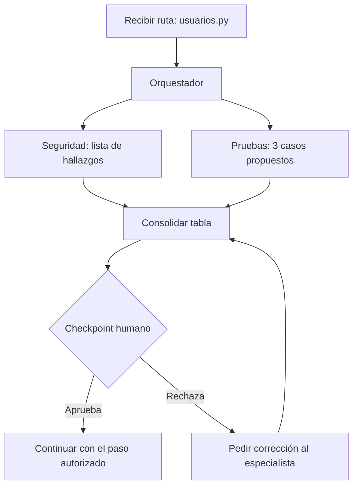
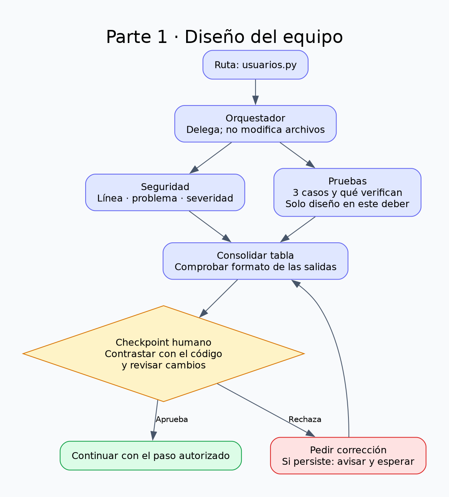

## Agentes

| Agente | Misión | Herramientas autorizadas | Entrada | Salida | Límites |
|---|---|---|---|---|---|
| Orquestador | Repartir la revisión y consolidar los resultados | Ninguna propia; solo delega | `usuarios.py` | Tabla con especialista, línea o función, hallazgo o caso y severidad o verificación | No modifica archivos |
| Especialista 1 — Seguridad | Buscar claves incrustadas y entradas sin validar, incluyendo las usadas en consultas SQL | Leer y buscar | `usuarios.py` | Lista: línea, problema y severidad | Solo ese archivo; no escribe ni ejecuta código; no reproduce valores de claves |
| Especialista 2 — Pruebas | Proponer 3 casos para `buscar_usuario`, `calcular_descuento` y `crear_usuario` | Leer | `usuarios.py` | Lista: nombre del caso y qué verifica | Solo propone; no escribe ni ejecuta pruebas; no afirma haber revisado pruebas externas |

## Flujo

Los especialistas pueden trabajar en paralelo porque no dependen entre sí. En la Parte 2 solo se implementará Seguridad; Pruebas queda diseñado.





## Checkpoint humano

La persona contrasta las líneas y los problemas con `usuarios.py`, revisa la severidad y comprueba que los casos tengan resultados esperados coherentes. También verifica que el archivo no haya cambiado. Rechaza hallazgos inventados, casos sin sentido o acciones fuera del alcance. Su aprobación permite continuar con el paso revisado.

## Detección y manejo de fallos

| Señal de fallo | Respuesta del orquestador |
|---|---|
| Salida vacía sin explicación, campos incompletos o cantidad de casos distinta de 3 | Pedir una corrección con el formato requerido |
| La revisión humana detecta líneas inexistentes o afirmaciones sin respaldo | Marcar el resultado como no verificado y solicitar corrección al especialista |
| El especialista intenta modificar archivos, ejecutar código o leer fuera del alcance | Detener la delegación y avisar a la persona |
| El fallo persiste después de una corrección | Informar que la revisión está incompleta y esperar una decisión humana |

El orquestador comprueba el formato de las salidas; la persona verifica su correspondencia con el código.

## A2A

El especialista de Pruebas pertenecería a otro equipo y recibiría encargos por red.

*Simplificación didáctica; no es JSON conforme a una versión específica de A2A.*

```json
{
  "name": "especialista-pruebas",
  "description": "Propone tres casos de prueba para un archivo Python.",
  "skills": [{
    "id": "proponer-pruebas",
    "description": "Devuelve nombre del caso y qué verifica."
  }],
  "interface": {
    "protocol": "A2A sobre HTTPS",
    "endpoint": "https://agente.ejemplo/a2a"
  },
  "capabilities": { "streaming": true },
  "security": {
    "authentication": "OAuth2",
    "requiredScope": "pruebas:proponer",
    "transport": "TLS"
  }
}
```

La tarjeta se obtendría de `https://agente.ejemplo/.well-known/agent-card.json`. El cliente validaría origen autorizado, certificado, skill, compatibilidad de interfaz y autenticación exigida. La tarjeta anuncia capacidades y seguridad; no ejecuta tareas ni demuestra confianza. [Descubrimiento A2A](https://a2a-protocol.org/latest/topics/agent-discovery/).

Secuencia: obtener Agent Card → verificar skill, interfaz y seguridad → enviar mensaje con el contenido autorizado de `usuarios.py` → recibir respuesta inmediata o una Task → consultar o recibir su estado → obtener el resultado como Artifact si hubo Task. La ruta local por sí sola no permite al servidor leer el archivo.

Estados: `submitted` significa recibido; `working`, en ejecución; `completed`, terminado. Ante `input-required`, el cliente pediría el dato faltante a la persona y continuaría la misma tarea. Ante `failed`, mostraría el error y evaluaría un nuevo intento; no presentaría un resultado exitoso. Una respuesta inmediata puede ser un mensaje sin crear Task. [Ciclo de la tarea](https://a2a-protocol.org/latest/topics/life-of-a-task/).

Frente al subagente local, aparecen descubrimiento, interfaz de red, interoperabilidad y otra frontera de confianza. El remoto administra sus permisos; no hereda acceso a nuestro repositorio. Solo se enviaría contenido autorizado y se revisarían sus resultados.

MCP conecta agentes con herramientas o recursos; A2A conecta agentes para delegar trabajo autónomo. Leer archivos puede hacerse con una herramienta local o MCP; encargar una revisión a un agente remoto puede usar A2A. La elección depende de la arquitectura y la interfaz, no de que la tarea lea archivos. No toda comunicación entre agentes es A2A. [A2A y MCP](https://a2a-protocol.org/latest/topics/a2a-and-mcp/).
